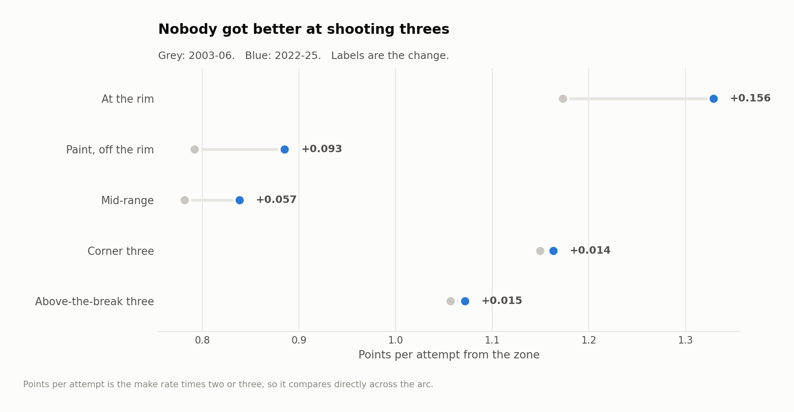
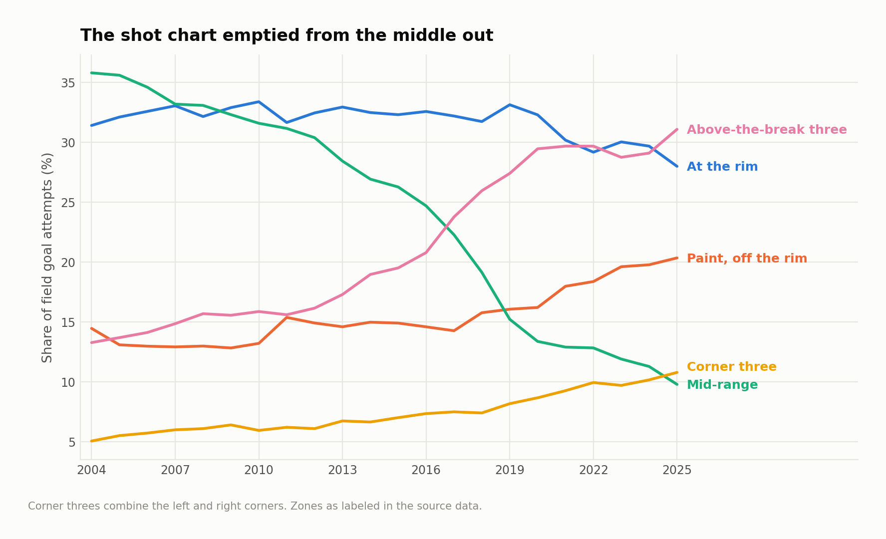
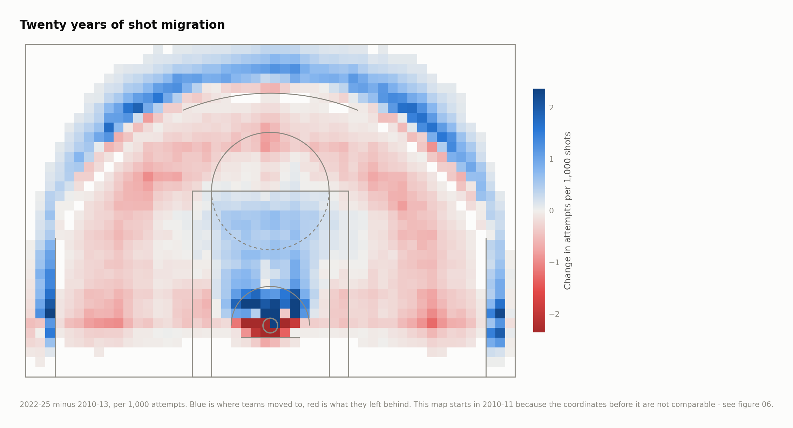
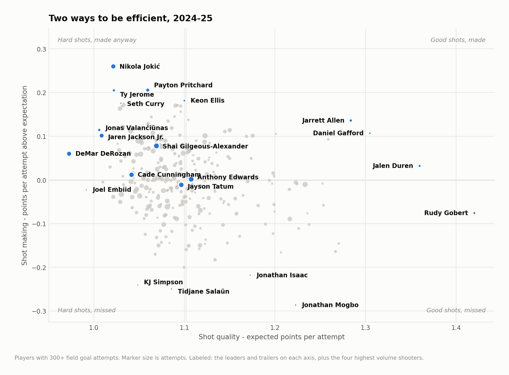
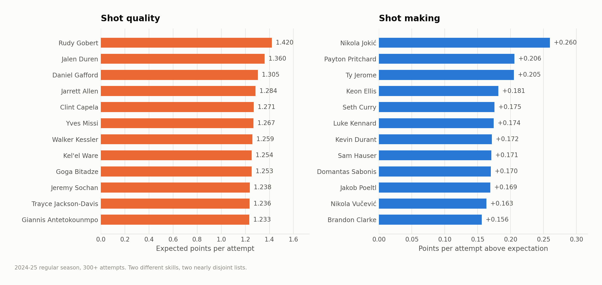
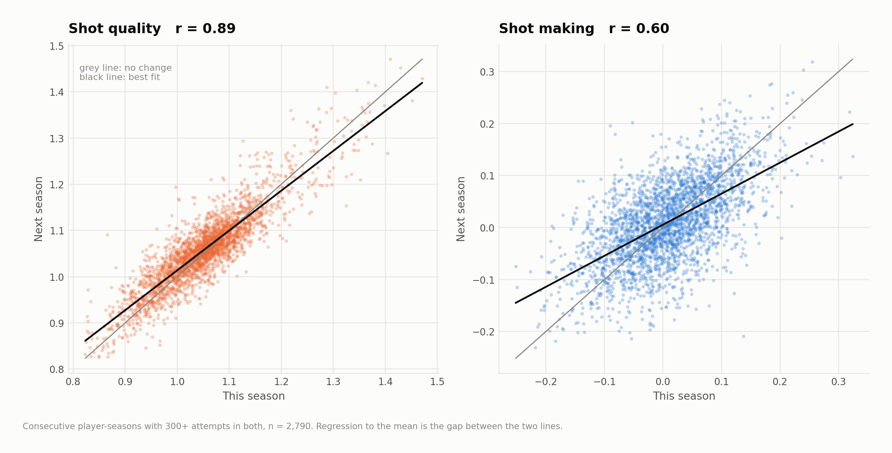
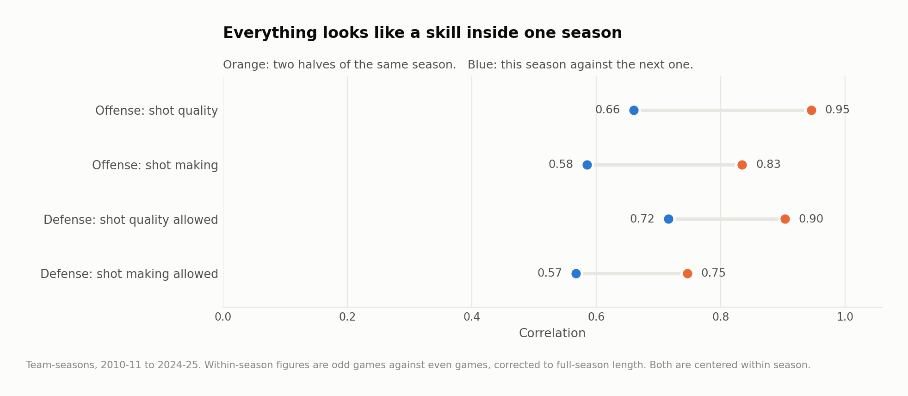
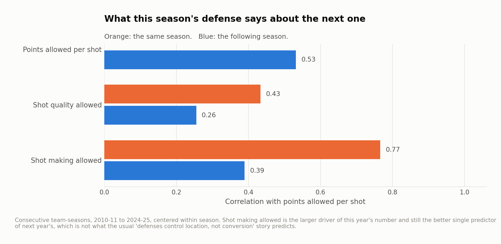
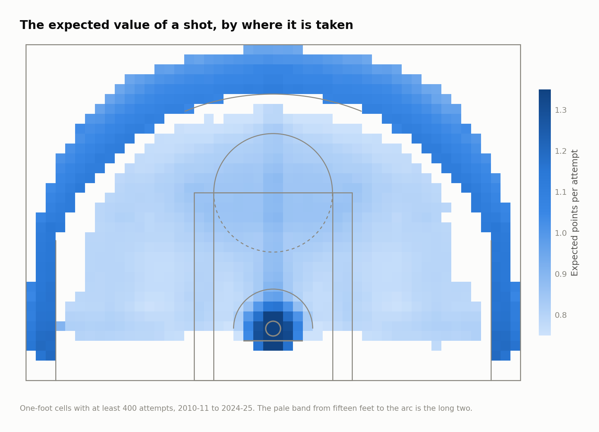

# Shot quality and shot making

An expected-value model over every NBA field goal attempt from 2003-04 through
2024-25 — 4,432,054 shots — used to separate two things that get reported as one
number: the shots a team or player generates, and what they do with them.

The identity is simple. For any set of attempts,

```
points per shot  =  expected points per shot  +  (actual − expected)
                    ────────────────────────     ─────────────────────
                        the shots you take         the shots you make
```

Everything below is one of those two terms.

---

## The finding I did not expect

The standard account of the last twenty years is that offenses got more efficient
because they learned arithmetic: threes and layups beat long twos, so teams
stopped taking long twos. League efficiency went up because the shot chart got
smarter.

The shot chart did get smarter. It is worth a little over a third of the gain.

League points per field goal attempt went from **0.946 to 1.090** between 2003-04
and 2024-25 (effective field goal percentage .473 to .545). Holding conversion
fixed at the league's own all-era rate in each zone, and letting only the mix of
zones move, accounts for **+0.054 of that, 38%**. The other **+0.090, 62%**, is
teams converting better from the same places on the floor.

And the conversion gain is not where the story says it should be:

| Zone | Points per attempt, 2003-06 | 2022-25 | Change |
|---|---|---|---|
| At the rim | 1.173 | 1.329 | **+0.156** |
| Paint, off the rim | 0.792 | 0.885 | **+0.093** |
| Mid-range | 0.782 | 0.839 | **+0.057** |
| Corner three | 1.150 | 1.163 | +0.014 |
| Above-the-break three | 1.057 | 1.072 | +0.015 |

League three-point percentage over those twenty-two seasons: **.354 to .363**.
Two-point percentage: **.460 to .545**.

Three-point volume went from 18% of attempts to 42%, and three-point accuracy went
essentially nowhere. What moved was the two. The revolution's payoff was never
that the league learned to shoot from distance. It was that pulling five defenders
out to the arc made everything inside it easier, and the scoreboard collected on
the layups.




The mix moved a long way to produce that +0.054. Mid-range attempts fell from 36%
of all shots to under 10%; above-the-break threes went from 13% to 31%.





Whether the easier twos come from better spacing, better finishers, or twenty
years of rule changes around contact, this data cannot say — a public shot file
has no defender in it. What it can say is where to stop looking. Three-point
accuracy is not the lever it is usually described as.

`src/run_07_robustness.py` rebuilds that split six more ways: the gradient-boosted
geometry model over all seasons and over the modern era alone, the zone yardstick
on the same modern window, a model trained on three middle seasons and applied out
of era, and distance alone. Every specification that avoids a feature which
drifted puts the location share between 22% and 48%. The one that disagrees is
the one that uses a drifting feature, and it is in the table by name.

---

## The two things that nearly broke it

My first version of this used a richer model — location plus the shot's action
type ("driving layup", "step back jump shot", "tip shot") plus clock and venue. It
scores better on every metric. It also produced the opposite answer: 113% of the
gain from shot selection, with conversion *declining*.

That answer was an artifact, and finding out why is the part of this project I
would defend hardest in a room. There were two problems, and they are both in the
source data rather than in the model.

**The action-type vocabulary changed mid-sample.** "Floating jump shot",
"pull-up jump shot" and "step back jump shot" do not appear anywhere in the
2003-04 file. They enter the data between 2007 and 2009 and now account for 28%
of all attempts. The plain "layup shot" they were carved out of falls from 16.2%
of attempts to 1.6% over the same period. Nobody stopped shooting layups; the
scorer's table started writing them down differently.

**Shot coordinates changed too.** Before 2010-11, roughly four out of five
restricted-area attempts are logged at the rim's own coordinate rather than where
the shot was taken. A quarter of *all* attempts in those seasons sit at exactly
zero feet, against 5% afterwards — and those "zero-foot" shots convert at 60%
before the change and 76% after, because afterwards only real dunks and tip-ins
get filed there.


A model handed either feature will read a change in the scorer's table as a change
in basketball. So the era comparison uses a five-bucket zone label and nothing
else, because a zone is the only description of a shot whose meaning is the same
at both ends of the sample, and anything that leans on fine coordinates —
the value surface, the migration map, the reliability work — starts in 2010-11.
The richer model is still the better model *within* a season, where the
vocabulary is stable, and that is the only place it is used.

I would rather have a worse instrument that means the same thing at both ends than
a better one that does not.

---

## Two skills, and how long each takes to see

Splitting a player-season the same way gives shot quality (the average expected
value of what he took) and shot making (points per attempt above that). In 2024-25
the two lists barely intersect — one player appears in both top twenties — and
across all qualified player-seasons the two are mildly *negatively* correlated
(r = −0.21). Players who generate good looks are, if anything, slightly worse at
making hard ones.





Rudy Gobert led the league in shot quality in 2024-25 at 1.42 expected points per
attempt, which is what happens when a player takes nothing but shots at the rim.
Nikola Jokić led in shot making at +0.260 per attempt over 1,335 attempts — 347
points above what a league-average shooter would have scored on the same shots,
and the largest single-season figure in the file.

The more useful question is how fast each one becomes trustworthy. Taking two
disjoint random samples of *m* attempts from the same player-season and
correlating across players, averaged over twelve draws:

| Attempts in each half | Shot quality | Shot making |
|---|---|---|
| 50 | 0.78 | 0.17 |
| 100 | 0.87 | 0.27 |
| 200 | 0.92 | 0.41 |
| 400 | 0.93 | 0.56 |
| 600 | 0.95 | 0.68 |

Shot quality is half signal inside 25 attempts. Shot making needs **303**. A
40-game sample of a role player's shot making is close to noise; the same sample
of his shot profile is close to settled.


Season to season, with 300+ attempts in both years (n = 2,790): shot quality
carries at r = 0.89, shot making at 0.60, and raw points per shot at 0.69. Shot
making is a real skill. It is a slow one to measure, and the number of attempts
most in-season arguments are built on is nowhere near enough.



---

## The same split on defense

Every shot has a defense attached: the other team in the game. Reversing the
identity gives shot quality allowed and shot making allowed.

The usual claim is that defenses control location and not conversion. The data
does not support the strong version of it. Inside a single season both halves look
like skills, because a team-season is about 7,000 opponent attempts and almost
anything is stable at that sample. Across seasons they separate, but not cleanly:
shot quality allowed carries at r = 0.72, shot making allowed at 0.57.



And when you ask which half of this season's defense predicts *next* season's
points allowed per shot, shot making allowed wins — standardized β = 0.48 against
0.37 for shot quality allowed, both far past significance, R² = 0.28 over 418
consecutive team-seasons.

That is worth sitting with. Without defender data, contest quality is invisible to
a location model, so a defense that consistently runs shooters off the line and
gets a hand up shows up as "luck". The persistence of that residual is evidence it
is not luck. It is defense the public files cannot see.



---

## The model

Gradient-boosted classifier on P(make), multiplied by 2 or 3, in two
specifications.

| Specification | AUC | Log loss | Brier |
|---|---|---|---|
| Geometry only | 0.627 | 0.658 | 0.233 |
| Geometry + action + clock (within season) | 0.664 | 0.636 | 0.224 |
| Distance only | 0.624 | 0.659 | 0.233 |
| League make rate | 0.500 | 0.690 | 0.248 |

Three choices that matter more than the hyperparameters:

**Every prediction is out of fold, split by game.** No shot is scored by a model
that saw another shot from the same game. Skip this and a player's shot-making
residual partly measures the model memorising him.

**No season term.** With one, league-wide changes in conversion get absorbed into
the expectation and the era decomposition collapses to zero by construction.

The geometry model's expected value as a surface, one square foot at a time:



**Calibration over discrimination.** AUC on a single shot is capped low — most of
the variance in whether one jumper goes in is irreducible, and a shot model that
scores much higher is reading something it should not. What the decomposition
needs is that the expectations are unbiased in aggregate, and they are: across 20
equal-count bins the largest gap between predicted and actual is 0.002 for the
geometry model and 0.004 for the full one, and mean expected points equals mean
actual points to four decimals.

---

## What this does not measure

- **Openness.** The public shot files carry no defender distance and no shot
  clock. "Shot quality" here is the quality of the spot, not of the possession. A
  wide-open 26-footer and a contested one are the same row.
- **Free throws.** Points per *field goal attempt*, so a player who draws fouls
  instead of shooting over them is undercounted. Shot value, not offensive value.
- **Playmaking.** Credit lands entirely on the shooter. The pass that created the
  look is not in this data.
- **Regular season only**, 2003-04 forward, which is where the coordinate files
  begin.

---

## Running it

```bash
pip install -r requirements.txt
python src/run_01_build.py        # raw season files -> one model-ready table
python src/run_02_fit.py          # both specifications, out-of-fold  (~10 min)
python src/run_03_league.py       # era decomposition, figures 01-06
python src/run_04_players.py      # player-season metrics, figures 07-08
python src/run_05_reliability.py  # split-half and year-over-year, figures 09-10
python src/run_06_defense.py      # the defensive side, figures 11-12
python src/run_07_robustness.py   # six attempts to break the headline
```

Or `make all`. Stage 2 is the only slow step; everything after it reads its
cached output.

```
src/
  config.py       paths, seasons, thresholds, the coordinate-era cutoff
  features.py     raw rows -> features, action families, coordinate repair
  model.py        the two specifications and the out-of-fold fit
  court.py        half-court drawing in the data's own coordinates
  labels.py       collision-resolving point labels for the scatterplots
  style.py        one place that decides what every figure looks like
  run_0*.py       the pipeline, in order
output/           every number quoted above, as CSV
figures/          twelve figures, regenerated from scratch by the pipeline
docs/method.md    longer notes on the decomposition and its assumptions
```

## Data

Shot-level files from [DomSamangy/NBA_Shots_04_24](https://github.com/DomSamangy/NBA_Shots_04_24),
which packages the NBA's public shot chart endpoint by season. `data/README.md`
has the fetch step. The raw files are about 850 MB unzipped and are not committed;
the derived tables in `output/` are, so every number in this README can be checked
without rerunning anything.

Three of the twenty-two season files are published on a different coordinate scale
from the other nineteen — x compressed by a factor of ten, y compressed and
shifted. `features.normalise_coordinates` detects and inverts it, and
`output/build_audit.csv` records which seasons were repaired and the independent
cross-check that confirms it: recomputed distance now agrees with the files' own
distance column to within half a foot in all twenty-two.

## License

MIT. See `LICENSE`.
