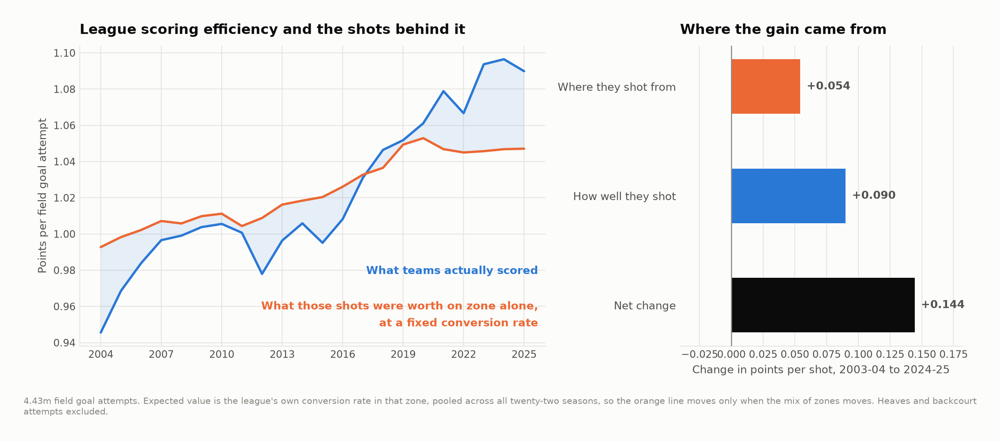
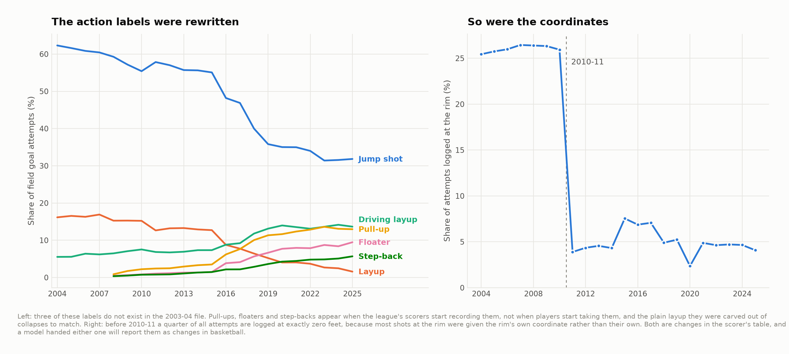
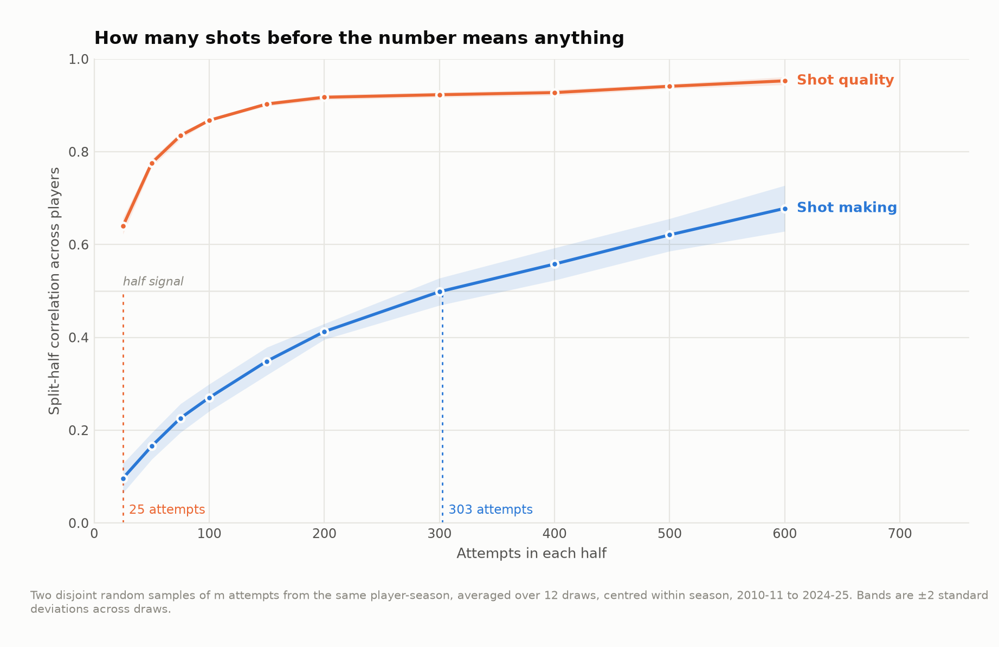

# Shot location, conversion and the NBA's efficiency change

How much of the increase in points per field-goal attempt coincided with a different shot mix, and how much with better conversion from the same broad zones? This study covers public shot files from 2003–04 through 2024–25.

The identity is exact: actual points per attempt equal an expected-value baseline plus the residual. The basketball interpretation depends on the baseline. A five-zone league yardstick is used for the long-run comparison because action labels and fine coordinates changed during the sample.

## The era comparison

| Specification | Total change | Location component | Conversion component | Location share |
|---|---|---|---|---|
| headline: five-zone yardstick, no model | 0.144 | 0.054 | 0.090 | 0.376 |
| geometry model, out of fold, all seasons | 0.144 | 0.049 | 0.095 | 0.339 |
| geometry model, 2011- only | 0.089 | 0.024 | 0.066 | 0.265 |
| five-zone yardstick, 2011- only | 0.089 | 0.043 | 0.046 | 0.479 |
| geometry trained on 2013-2015, 2011- only | 0.089 | 0.022 | 0.068 | 0.243 |
| distance and shot value only, 2011- only | 0.089 | 0.020 | 0.069 | 0.224 |
| full model, contaminated by label drift | 0.144 | 0.163 | -0.019 | 1.131 |

Source: [robustness.csv](output/robustness.csv).

Changes are points per field-goal attempt. Location share is a proportion of the total change.

The first row is the headline zone decomposition. Alternative rows show how the result changes with features and the time window. The location share is a descriptive allocation under each yardstick, not a causal estimate of what adopting threes did to league offense.



The underlying shot mix changed, and conversion within broad zones also changed. These data cannot separate spacing, finishing skill, defensive strategy, rule enforcement or changes in which attempts were available. The residual should not be called pure shooting talent.

## Model evaluation

| Model | Specification | ROC AUC | Log loss | Brier score |
|---|---|---|---|---|
| geometry only | Geometry model | 0.627 | 0.658 | 0.233 |
| geometry + action + clock | Recorded-context model | 0.664 | 0.636 | 0.224 |
| league make rate | base | 0.500 | 0.690 | 0.248 |
| distance only | dist | 0.624 | 0.658 | 0.233 |

Source: [model_report.csv](output/model_report.csv).

Gradient-boosted classifiers estimate make probability and multiply it by the value of a made shot. Predictions are generated with folds grouped by game. Those folds assess held-out games within the observed sample; they are not a chronological deployment test. A richer action-and-clock specification can fit observed shots better while being less suitable for cross-era comparison.



## Reliability is a separate question



The two samples are randomly drawn from the same player-season. They are not two consecutive stretches of games. A high split correlation therefore does not establish how many early-season games a team needs before making a decision. Across-season associations are also descriptive and may reflect persistent roles and teammate context.

The player tables report shot expectation and residual conversion at the published attempt thresholds. They omit free throws, turnovers and playmaking credit, so they do not rank overall offensive value.

## Reproducible release

The numerical tables and figures were regenerated together in a pinned Python environment. Earlier model outputs used incompletely specified dependency versions and do not belong in this release. Source hashes, dependency versions, calibration tables and robustness results accompany the article.

For a coaching application, combine the player's shot profile with film explaining how those opportunities arose. Improving a shot mix is not equivalent to replacing every low-value attempt with an equally available rim attempt.


## Reproduce

The historical analysis used Python 3.12 with the pinned dependencies below. From this repository:

```bash
python3.12 -m venv .venv
source .venv/bin/activate
python -m pip install -r requirements.txt
make fetch-data PY=python
make all PY=python
make report site PY=python
```

`make all` verifies source hashes before running the analyses in order. A missing or changed input stops the build. Data downloads need network access; article rendering uses the included result tables. See [the source manifest](data/source_manifest.json), [method notes](docs/method.md) and [current validation record](VALIDATION_CURRENT.md) for the distinction between a source rebuild and checks of delivered outputs.

Season keys in CSV files use the **ending year**: `2025` means 2024–25. Display tables use full season labels. The MIT license covers code; third-party data retain their providers' rights and terms.

[Portfolio](https://github.com/jmsmarrelli/basketball-analytics) · [AI assistance and provenance](PROVENANCE.md)
